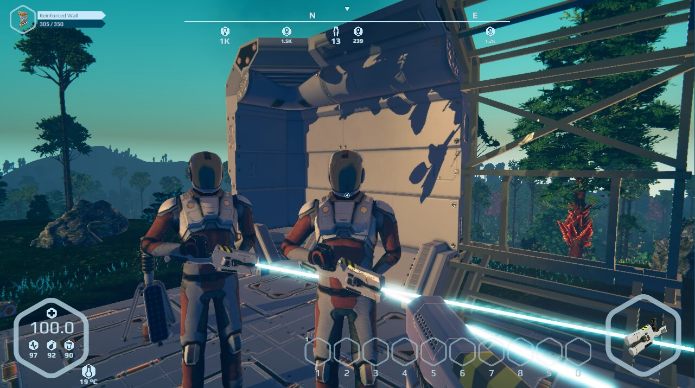

# Planet Nomads Multiplayer

**An unofficial multiplayer mod for the original Planet Nomads game — not a rebuilt game.**

This project uses a BepInEx-injected client plugin, a separate dedicated server and a Windows manager. You still run the original **PlanetNomads.exe**, with its original game assets, rendering and single-player modes.

> **Development preview.** Working connectivity and the launcher are verified on the project's test machine. Full multiplayer synchronization is not yet implemented.

## Current builds

| Component | Version | Notes |
| --- | --- | --- |
| Multiplayer Manager | **0.1.21** | Windows desktop launcher / installer tested |
| Injected multiplayer client | **0.3.8** | Runs within Planet Nomads 1.0.7.2 |
| Dedicated server | **0.3.7** | .NET Framework 4.7.2, separate headless process |

## What works today

- A conventional Windows installer for the manager, with Start Menu and desktop shortcuts.
- Manager detects game locations, installs/upgrades/uninstalls the multiplayer components, and preserves existing saves and unrelated game files.
- Original single-player menus remain available alongside the added Multiplayer entry.
- Dedicated server loads an existing Planet Nomads world from `Saves/<World>` and clients can join.
- Client profile identity persists across sessions; dedicated server can verify the configured local administrator.
- Manager launches the dedicated server without a separate terminal, displays its live console and offers **Launch Server**, **Save**, **Shutdown**, **Restart**.
- Manager launches the original game directly, keeping the current manager panel visible and suppressing launcher audio.
- Settings include launcher music/UI sounds, game command-line options and player-profile backup/restore.

## Installing

See **[Installation guide](docs/INSTALLATION.md)** and **[Server configuration](docs/SERVER.md)**.

The manager needs the **.NET 8 Desktop Runtime (x64)**. The client mod needs an existing licensed copy of **Planet Nomads 1.0.7.2**. The original game is **not distributed** here.

**Installer:** `PlanetNomadsManager-0.1.21-Setup.exe` has been compiled and installation-tested on Windows.

## Project layout

- `docs/INSTALLATION.md` — requirements and installation workflow.
- `docs/SERVER.md` — dedicated server setup, world folders, ports and administration.
- `docs/MANAGER.md` — manager panels and options.
- `docs/STATUS.md` — tested behaviour and outstanding work.
- `docs/RELEASING.md` — installer packaging and publication checklist.

**Distribution policy:** This repository publishes documentation and compiled releases only. The manager, injected client mod and dedicated-server source code remain private and are not offered for distribution. Original game binaries, Unity assemblies and personal world databases are not distributed.

## Disclaimer

Unofficial fan-made modification. Not affiliated with Craneballs or the Planet Nomads rights holders. All original game trademarks, code and assets belong to their respective owners. You must obtain the original game separately.
