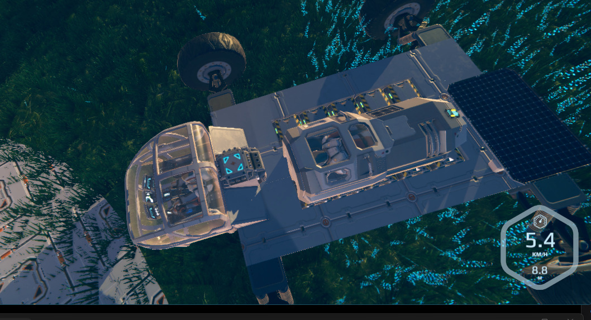

# Planet Nomads Multiplayer

**Multiplayer for the original Planet Nomads — a mod, not a game rebuild.**

Play the original Planet Nomads with a multiplayer client mod, a dedicated server and a Windows manager to install and control them.

## Included

| Component | Version |
| --- | --- |
| Multiplayer Manager | **0.1.28** |
| Multiplayer client mod | **0.3.30** |
| Dedicated server | **0.3.30** |

## What's new in 0.3.30

- **Consistent day/night skies:** Corrected differing sun and sky positions between players by waiting for the live server-authoritative clock before completing world loading. Multiplayer sky progression now follows a common rate.
- **Driven and undriven cockpit occupants:** Players seated in either type of cockpit are represented to other clients, including stationary vehicles, late joiners and cockpit exits.
- **Either empty cockpit works:** With two empty adjacent rounded cockpits, either can be occupied. Seated presentation follows the cockpit's actual occupancy event and native seat pivot, rather than assuming one fixed passenger-only presentation position. This does not change who controls the vehicle: driving authority and physics leasing remain separate.
- **Manager 0.1.28:** Avoids attempting automatic profile backups while another Planet Nomads client is still running against the same LocalLow profile database. Normal backup can proceed after the final client closes.

### Also included from previous releases

- Player respawning on death, with selection of available drop pods and Cryopods.
- Synchronised sleeping in Sleeping Bags and powered Cryopods. All connected players must agree to sleep before shared time acceleration begins.
- Synchronised physics authority leasing for vehicles and dynamic constructions, including articulated structures, vehicle controls and remote wheel rotation.
- Multiplayer passenger transport, including occupied Cryopods mounted on vehicles.
- Synchronised electrical grids and connections, battery charge levels and charging/discharging timers. Parked vehicles can connect to a base electrical grid for charging.
- Enclosed vehicle cockpits and Cryopods exclude water when submerged.
- Improved water rendering performance, frame pacing, player instantiation and initial world synchronisation on joining a server.
- Fixed the Emergency Printer incorrectly requiring an external power supply in multiplayer.
- Added the **Biomass Stove**, a starter construction for producing dried fruitage, dried meat and purified water using biomass fuel.

### New construction from 0.3.27: Biomass Stove

Available from the beginning of multiplayer survival, the Biomass Stove is a self-contained appliance with an internal power supply. Add biomass fuel and the recipe ingredients, then queue production of dried fruitage, dried meat or purified water. No external power grid or unlocked Fabricator is required.

  
  

### Manager 0.1.28

The Manager ships the 0.3.30 client and dedicated server payloads, along with separate client/server installation and per-world gameplay settings. **Known display issue:** this Manager build may still show 0.3.27 for both packaged components because its version labels are hardcoded. The version reporting will be corrected in the next scheduled update; see [issue #24](https://github.com/fistmaster2k4/Planet-Nomads-Multiplayer/issues/24). See [Manager controls](docs/MANAGER.md) and [starter worlds](docs/SERVER.md#included-starter-worlds).

> **Important:** Worlds created using older versions of Planet Nomads Multiplayer are not guaranteed to be compatible with this release. Back up existing worlds before updating. For the best experience, start a new world using one of the included starter worlds.

## Working and tested

- Windows installer, desktop icon and Start Menu shortcut.
- Independent client and dedicated-server installation and updates, with confirmation and backups for modified files.
- Manager launch, save, restart and clean shutdown of the dedicated server.
- Multiplayer client connection to a dedicated server.
- Server time applied when players join or reconnect, with native day/night progression between events.
- Server-owned weather schedules for the game's 25 biome profiles.
- Remote players' flashlights illuminate the environment at night, with on/off state synchronised to other clients.
- Dropped items appear at shared positions for connected players and can be collected by either player (verified in-game).
- Server-owned dropped-item state supports partial pickups, late joiners and restart recovery (automated regression tests passed; broader in-game verification ongoing).
- Original single-player game modes and menus remain available.
- Custom world loading from the dedicated server.
- Persistent player identity and configured server administrator recognition.
- Game launch from the manager, with the server console left visible.

## Current limitations

- The manager does not yet have a connected-player list or kick/ban buttons.
- Dedicated-server query is not active.
- Some multiplayer gameplay interactions and world changes are not yet synchronised; not every vehicle configuration or persistence edge case has been exhaustively tested.
- SteamOS/Linux client support through Proton is experimental.

## Get started

- [Installation instructions — manager or standalone client](docs/INSTALLATION.md)
- [Dedicated server and custom worlds](docs/SERVER.md)
- [Manager controls](docs/MANAGER.md)
- [Releases](https://github.com/fistmaster2k4/Planet-Nomads-Multiplayer/releases)

**Manager requirements:** Windows 10/11 and .NET 8 Desktop Runtime (x64). A Planet Nomads 1.0.7.2 installation is required to install the client, but not to install the dedicated server.

## Optional companion control panel — ROCCAT Power-Grid

Turn an Android phone or tablet into an external Planet Nomads control panel using [Power-Grid Rescue](https://github.com/fistmaster2k4/Power-Grid-Rescue).

  

The custom Planet Nomads grid includes five configurable controls for base lights, generators, printers, vehicle headlights and drive wheels, mapped to NumPad 1–5. Assign those shortcuts to your equipment or electrical switches in-game and operate them from your tablet.

- **[Planet Nomads grid — download and setup instructions](https://github.com/fistmaster2k4/Power-Grid-Rescue/tree/main/Grids/New/Planet%20Nomads)**
- [Power-Grid Rescue — restored Windows host and Android client](https://github.com/fistmaster2k4/Power-Grid-Rescue)

This is an optional companion grid using the game's native keyboard shortcuts. It works independently of the multiplayer mod and requires no additional game plugin. The ON indicator is momentary button-press feedback, not live equipment status.

**Need the original game?** It's available on GOG: [Planet Nomads on GOG](https://www.gog.com/en/game/planet_nomads).

**Unofficial fan-made mod.** Not affiliated with Craneballs. Planet Nomads and its original assets belong to their respective rights holders.

**Distribution:** Compiled releases and user guides only. Project source code is private.
