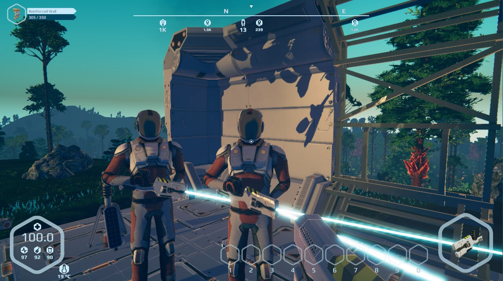
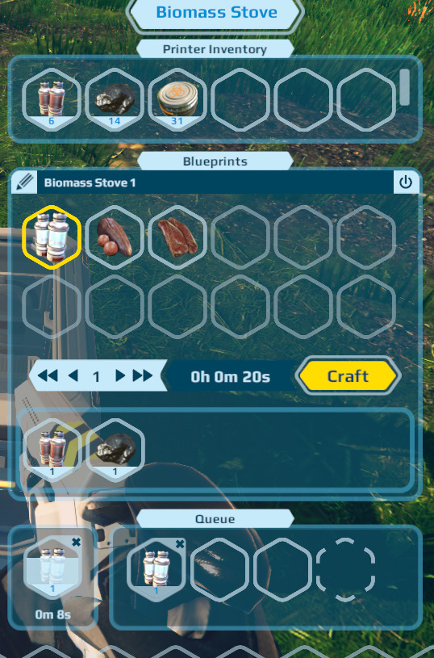

# Planet Nomads Multiplayer

**Multiplayer for the original Planet Nomads — a mod, not a game rebuild.**

Play the original Planet Nomads with a multiplayer client mod, a dedicated server and a Windows manager to install and control them.

## Included

| Component | Version |
| --- | --- |
| Multiplayer Manager | **0.1.30** |
| Multiplayer client mod | **0.3.36** |
| Dedicated server | **0.3.36** |

## What's new in 0.3.36

### Replicator blueprints now persist in multiplayer

Constructions printed through the game's native **Replicator** are registered with the dedicated server, including locally saved and Steam Workshop blueprints. Printed structures and vehicles remain in the shared world when players disconnect and reconnect.

Registration includes generated child grids, suspension assemblies, electrical connections and functional component settings. The update also resolves cockpit authority problems affecting newly printed vehicles and supports blueprints whose components are offset from the root coordinate.

A Steam player can print a Workshop vehicle and a GOG player joining the same dedicated server can see and use it. This cross-platform behaviour and reconnect persistence have been verified in-game.

> **Note:** Players may experience a short delay after printing a Steam Workshop blueprint while the construction is handed off to the server. The vehicle may take time to settle and become interactive.

### Manager 0.1.30

**PLAY GAME** now starts Steam installations through Steam, retaining Steam Workshop access and the Steam overlay. GOG installations continue to launch the game executable directly.

The **OPTIONS → PLAYER PROFILE → REPORT BUG** control creates `NomadsBugReport.zip` containing available client, dedicated-server and native game logs plus installed version information. It lets you choose a save location (defaulting to the dedicated-server folder), shows where the file was saved and opens the GitHub issue tracker. World saves and databases are excluded. 

Manager 0.1.30 bundles client and dedicated server **0.3.36**.

## Previous release: 0.3.34

### Biomass Miner — multiplayer automation

The **Biomass Miner** is now supported in multiplayer. Place it where it makes contact with the terrain and power it to produce organic matter automatically. The miner uses the game's existing terrain-placement detection to establish valid ground contact, rather than a costly new terrain scan.

Production and its output container can be used in a shared multiplayer world. Its interface shows drilling progress, estimated hourly yield and harvested material. It also offers the native option to use connected containers when its internal storage is full.

### Multiplayer quality-of-life fixes

- **Respawning:** Corrected problems with multiplayer death and respawn handling.
- **Logging out of vehicles:** Occupied vehicles are exited correctly on player logout, avoiding the previously observed death-on-logout behaviour.
- **In-game pause menu:** Simplified to **Continue**, **Options** and **Logout**. Logout now returns from the multiplayer session without closing the entire game.

### Also included from previous releases

- Player respawning on death, with selection of available drop pods and Cryopods.
- Synchronised sleeping in Sleeping Bags and powered Cryopods. All connected players must agree to sleep before shared time acceleration begins.
- Synchronised physics authority leasing for vehicles and dynamic constructions, including articulated structures, vehicle controls and remote wheel rotation.
- Multiplayer passenger transport, including occupied Cryopods mounted on vehicles.
- Synchronised electrical grids and connections, battery charge levels and charging/discharging timers. Parked vehicles can connect to a base electrical grid for charging.
- Enclosed vehicle cockpits and Cryopods exclude water when submerged.
- Improved water rendering performance, frame pacing, player instantiation and initial world synchronisation on joining a server.
- Fixed the Emergency Printer incorrectly requiring an external power supply in multiplayer.
- Added the **Biomass Stove**, a starter construction for producing dried fruitage, dried meat and purified water using biomass fuel.

### New construction from 0.3.27: Biomass Stove

Available from the beginning of multiplayer survival, the Biomass Stove is a self-contained appliance with an internal power supply. Add biomass fuel and the recipe ingredients, then queue production of dried fruitage, dried meat or purified water. No external power grid or unlocked Fabricator is required.

  
  

### Manager installation and world controls

The Manager provides independent client and dedicated-server installation and update controls, plus per-world gameplay settings. It recognises managed files changed outside the Manager and supports updating either component separately. See [Manager controls](docs/MANAGER.md) and [starter worlds](docs/SERVER.md#included-starter-worlds).

> **Important:** Worlds created using older versions of Planet Nomads Multiplayer are not guaranteed to be compatible with this release. Back up existing worlds before updating. For the best experience, start a new world using one of the included starter worlds.

## Multiplayer features

- Windows installer, desktop icon and Start Menu shortcut.
- Independent client and dedicated-server installation and updates, with confirmation and backups for modified files.
- Manager launch, save, restart and clean shutdown of the dedicated server.
- Multiplayer client connection to a dedicated server.
- Server time applied when players join or reconnect, with native day/night progression between events.
- Server-owned weather schedules for the game's 25 biome profiles.
- Remote players' flashlights illuminate the environment at night, with on/off state synchronised to other clients.
- Dropped items appear at shared positions for connected players and can be collected by either player (verified in-game).
- Server-owned dropped-item state supports partial pickups, late joiners and restart recovery (broader in-game verification ongoing).
- Original single-player game modes and menus remain available.
- Custom world loading from the dedicated server.
- Persistent player identity and configured server administrator recognition.
- Game launch from the manager, with the server console left visible. Steam installations launch through Steam; GOG installations launch directly.

## Current limitations

- The manager does not yet have a connected-player list or kick/ban buttons.
- Dedicated-server query is not active.
- Some multiplayer gameplay interactions and world changes are not yet synchronised; not every vehicle configuration or persistence edge case has been exhaustively tested.
- SteamOS/Linux client support through Proton is experimental.

## Get started

- [Installation instructions — manager or standalone client](docs/INSTALLATION.md)
- [Sharing blueprints between Steam and GOG](docs/BLUEPRINTS.md)
- [Dedicated server and custom worlds](docs/SERVER.md)
- [Manager controls](docs/MANAGER.md)
- [Releases](https://github.com/fistmaster2k4/Planet-Nomads-Multiplayer/releases)

**Manager requirements:** Windows 10/11 and .NET 8 Desktop Runtime (x64). A Planet Nomads 1.0.7.2 installation is required to install the client, but not to install the dedicated server.

## Optional companion control panel — ROCCAT Power-Grid

Turn an Android phone or tablet into an external Planet Nomads control panel using [Power-Grid Rescue](https://github.com/fistmaster2k4/Power-Grid-Rescue).

  

The custom Planet Nomads grid includes five configurable controls for base lights, generators, printers, vehicle headlights and drive wheels, mapped to NumPad 1–5. Assign those shortcuts to your equipment or electrical switches in-game and operate them from your tablet.

- **[Planet Nomads grid — download and setup instructions](https://github.com/fistmaster2k4/Power-Grid-Rescue/tree/main/Grids/New/Planet%20Nomads)**
- [Power-Grid Rescue — restored Windows host and Android client](https://github.com/fistmaster2k4/Power-Grid-Rescue)

This is an optional companion grid using the game's native keyboard shortcuts. It works independently of the multiplayer mod and requires no additional game plugin. The ON indicator is momentary button-press feedback, not live equipment status.

**Need the original game?** It's available on GOG: [Planet Nomads on GOG](https://www.gog.com/en/game/planet_nomads).

**Unofficial fan-made mod.** Not affiliated with Craneballs. Planet Nomads and its original assets belong to their respective rights holders.

**Distribution:** Compiled releases and user guides only. Project source code is private.
