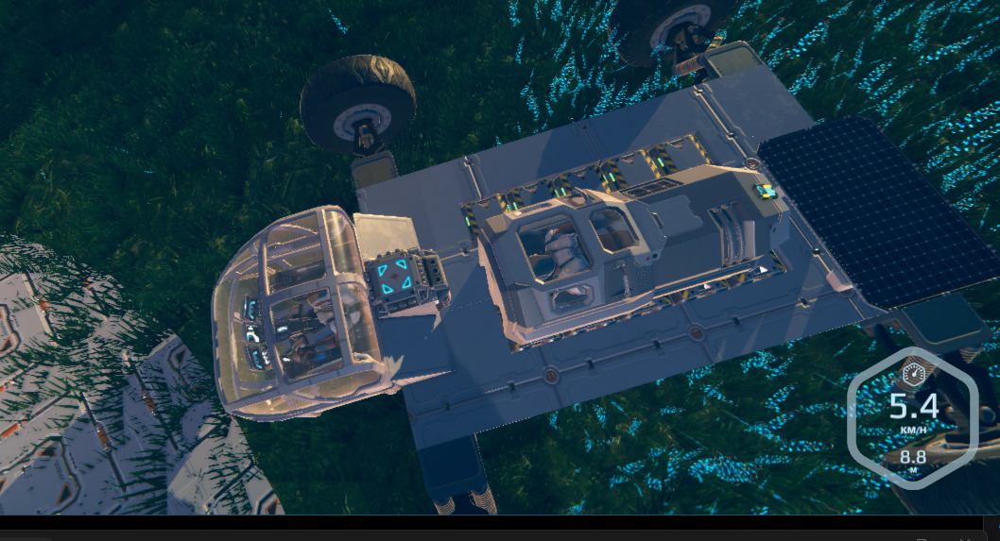
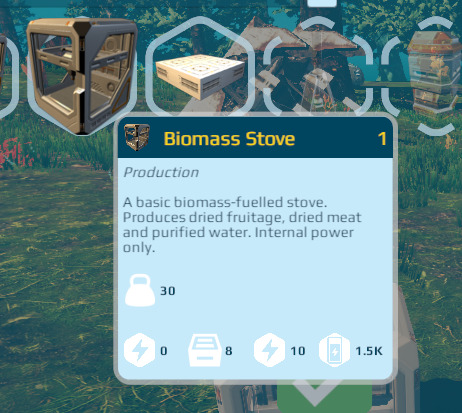
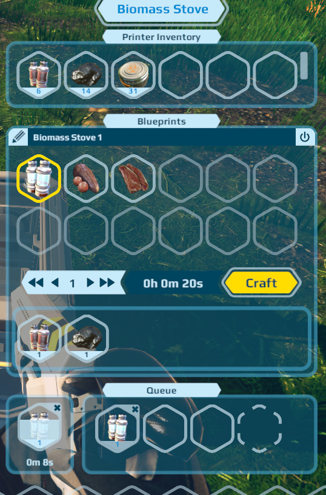

# Planet Nomads Multiplayer

**Multiplayer for the original Planet Nomads — a mod, not a game rebuild.**

Play the original Planet Nomads with a multiplayer client mod, a dedicated server and a Windows manager to install and control them.

## Included

| Component | Version |
| --- | --- |
| Multiplayer Manager | **0.1.27** |
| Multiplayer client mod | **0.3.27** |
| Dedicated server | **0.3.27** |

## What's new in 0.3.27

- Player respawning on death, with selection of available drop pods and Cryopods.
- Synchronised sleeping in Sleeping Bags and powered Cryopods. All connected players must agree to sleep before shared time acceleration begins.
- Synchronised physics authority leasing for vehicles and dynamic constructions, including articulated structures, vehicle controls and remote wheel rotation.
- Multiplayer passenger transport, including occupied Cryopods mounted on vehicles.
- Synchronised electrical grids and connections, battery charge levels and charging/discharging timers. Parked vehicles can connect to a base electrical grid for charging.
- Enclosed vehicle cockpits and Cryopods exclude water when submerged.
- Improved water rendering performance, frame pacing, player instantiation and initial world synchronisation on joining a server.
- Fixed the Emergency Printer incorrectly requiring an external power supply in multiplayer.
- Added the **Biomass Stove**, a new starter construction for producing dried fruitage, dried meat and purified water using biomass fuel.

### New construction: Biomass Stove

Available from the beginning of multiplayer survival, the Biomass Stove is a self-contained appliance with an internal power supply. Add biomass fuel and the recipe ingredients, then queue production of dried fruitage, dried meat or purified water. No external power grid or unlocked Fabricator is required.

  
  

### Manager 0.1.27

The Manager includes client and dedicated server 0.3.27, an expanded two-column server settings interface, per-world gameplay configuration and three pre-generated starter worlds with different terrain settings. See [Manager controls](docs/MANAGER.md) and [starter worlds](docs/SERVER.md#included-starter-worlds).

> **Important:** Worlds created using older versions of Planet Nomads Multiplayer are not guaranteed to be compatible with this release. Back up existing worlds before updating. For the best experience, start a new world using one of the included starter worlds.

## Working and tested

- Windows installer, desktop icon and Start Menu shortcut.
- Independent client and dedicated-server installation and updates, with confirmation and backups for modified files.
- Manager launch, save, restart and clean shutdown of the dedicated server.
- Multiplayer client connection to a dedicated server.
- Server time applied when players join or reconnect, with native day/night progression between events.
- Server-owned weather schedules for the game's 25 biome profiles.
- Remote players' flashlights illuminate the environment at night, with on/off state synchronised to other clients.
- Dropped items appear at shared positions for connected players and can be collected by either player (verified in-game).
- Server-owned dropped-item state supports partial pickups, late joiners and restart recovery (automated regression tests passed; broader in-game verification ongoing).
- Original single-player game modes and menus remain available.
- Custom world loading from the dedicated server.
- Persistent player identity and configured server administrator recognition.
- Game launch from the manager, with the server console left visible.

## Current limitations

- The manager does not yet have a connected-player list or kick/ban buttons.
- Dedicated-server query is not active.
- Some multiplayer gameplay interactions and world changes are not yet synchronised; not every vehicle configuration or persistence edge case has been exhaustively tested.
- SteamOS/Linux client support through Proton is experimental.

## Get started

- [Installation instructions — manager or standalone client](docs/INSTALLATION.md)
- [Dedicated server and custom worlds](docs/SERVER.md)
- [Manager controls](docs/MANAGER.md)
- [Releases](https://github.com/fistmaster2k4/Planet-Nomads-Multiplayer/releases)

**Manager requirements:** Windows 10/11 and .NET 8 Desktop Runtime (x64). A Planet Nomads 1.0.7.2 installation is required to install the client, but not to install the dedicated server.

**Need the original game?** It's available on GOG: [Planet Nomads on GOG](https://www.gog.com/en/game/planet_nomads).

**Unofficial fan-made mod.** Not affiliated with Craneballs. Planet Nomads and its original assets belong to their respective rights holders.

**Distribution:** Compiled releases and user guides only. Project source code is private.
