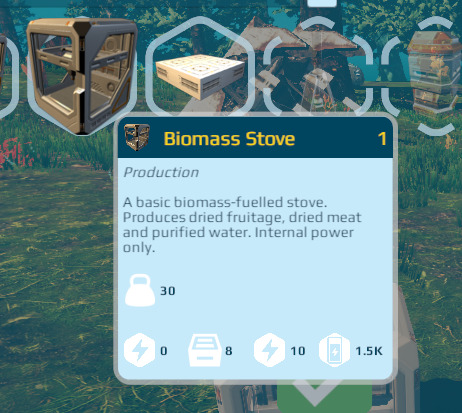

# Planet Nomads Multiplayer

**Multiplayer for the original Planet Nomads — a mod, not a game rebuild.**

Play the original Planet Nomads with a multiplayer client mod, a dedicated server and a Windows manager to install and control them.

**Compatibility: Planet Nomads Multiplayer supports vanilla Planet Nomads 1.0.7.2 only (Steam or GOG). Wand and imported custom blueprints that overwrite existing block IDs are not supported.**

## Included

| Component | Version |
| --- | --- |
| Multiplayer Manager | **0.1.35** |
| Multiplayer client mod | **0.3.69** |
| Dedicated server | **0.3.69** |

## What's new in 0.3.69

### Expanded server-authoritative world persistence

- Shared quest objectives, journal entries, story progression and technology unlocks are maintained by the server.
- Custom block labels are available immediately on joining, without having to inspect each block first.
- Doors retain their open or closed state.
- Cryopod respawn availability and selection follow the shared world state, including power availability.
- Winch and shackle connections, including cable length, persist between sessions.
- Plant pot growth, fruit maturity and harvesting follow the authoritative world clock, including time advanced through sleeping. Harvested plants retain their state on reconnect.
- Item spawner collection states persist so collected items do not reappear simply because a player reconnects.

### Server-authoritative trees

- Tree destruction and Terraformer restoration are controlled by the dedicated server.
- Joining clients no longer upload their local tree catalogue or overwrite existing tree provenance.
- Fixed tree provenance conflicts that could prevent players from joining existing worlds.
- Existing tree destruction and restoration records are retained.

### Fixes and upgrading

- Corrected winch, shackle and plant pot welding thresholds to match native game behaviour.
- Fixed plant maturity and harvesting availability by using the running authoritative world clock rather than a cleared loading-time clock replica.
- Existing multiplayer worlds can be upgraded without a world reset or deleting persistence databases. Back up the entire world folder before updating.

**Manager 0.1.35 includes matching multiplayer client and dedicated server 0.3.69.** Update both components together; use the matching 0.3.69 standalone client when installing manually.

## Previous release: 0.3.62

### Rotor settings, solar beacons and loading audio

- Small and large flight rotors now retain their idle hover, stabilisation, forward steering and side steering settings between multiplayer sessions. Rotor configurations are also captured when printing blueprints through the Replicator.
- Solar beacons correctly use their internal power supply without an external electrical connection. Navigation visibility, custom labels and selected navigation icons are persistent.
- Gameplay audio is suppressed during multiplayer world initialisation, reducing machinery and other sound effects behind the loading screen.
- Existing flight physics and vehicle controls remain unchanged.

**Manager 0.1.34 includes matching multiplayer client and dedicated server 0.3.62.** Update both components together; older clients and servers are not compatible with 0.3.62.

## Previous release: 0.3.60

### Moving Tool and object settings

- Fixed blocks moved with the Moving Tool disappearing after reconnecting ([#35](https://github.com/fistmaster2k4/Planet-Nomads-Multiplayer/issues/35)). Moved blocks retain their new position, orientation and existing settings, including inventory contents and machine production queues.
- Custom block names and action keybindings are now saved by the server and shared between players ([#36](https://github.com/fistmaster2k4/Planet-Nomads-Multiplayer/issues/36)).
- Moved block positions, switch keybindings and custom names on switches, doors and printers have been verified through reconnects and server restarts.
- Previously lost names and keybindings need to be reassigned.

All stability, performance and automatic database maintenance improvements from 0.3.59 are retained.

**Manager 0.1.33 includes matching multiplayer client and dedicated server 0.3.60.** Both must be updated together; older clients and servers are not compatible with 0.3.60.

Thanks to Cuddly Robot for reporting both issues.

## Previous release: 0.3.59

### Stability and performance

- Improved inventory and machine interface responsiveness, including a fix for an interaction that could leave the cursor visible without opening the inventory.
- Removed redundant inventory requests and accumulating callbacks.
- Improved vehicle responsiveness by removing expensive recurring server-side Terraformer obstruction checks. Necessary obstruction checks were approximately 60 times faster across seven restoration sites in our test world.
- Fixed Terraformer progress stalling following server restarts, overlay leakage into other machine interfaces and production queue icon alignment.
- Build Vision now defaults to OFF when joining a multiplayer world.
- Fixed players being ejected from vehicles.

### Container database maintenance

Fixed excessive growth of the dedicated server's container database caused by unnecessary persistent inventory transaction records. Existing affected databases are automatically cleaned on server startup, retaining current inventory and machine state. No manual database maintenance is required.

**Manager 0.1.32 includes matching multiplayer client and dedicated server 0.3.59.** Update both components together. This update is strongly recommended for existing servers.
*Launch the server at least once on each of the server saves (Day1-3 + Any you've created) to cleanup the excessively bloated containers.db*

## Previous release: 0.3.43

### New: Terraformer

The **Terraformer** restores trees you've previously harvested within a **100-metre radius**, using technology related to the huge planetary devices aboard your lost ship, originally intended for world colonisation.

It unlocks alongside the **Nuclear Generator** and requires substantial electrical power — at least a nuclear generator.

- Each restored tree requires **1 seed and 5 biomass**, placed in the Terraformer or connected storage containers.
- Each tree takes **two in-game days** to restore, based on the server world's configured day length.
- The machine shows restoration progress and remaining time, and preserves progress through server restarts.
- Once all eligible trees in its area are regrown, the machine stops consuming power.

  

**Overlapping Terraformers prevent each other from operating — spacing is vital!**

### Shared quests, journals and lore

- Quest objectives and completed quests are now shared across the server.
- Completed quests and journal entries persist through reconnects and server restarts.
- Discovered story logs and lore entries remain available to every player, including late joiners.
- Shared technology unlocks continue to work as before.

### Fixes and improvements

- Fixed harvested rocks and plants leaving remnants behind.
- Restored the **Biomass Stove** to starting build options.
- Fixed construction checkpoint errors preventing players from rejoining existing worlds.
- Corrected Terraformer timers and added progress and pause-status displays.
- Improved the Manager's detection of running dedicated servers, preventing duplicate launches and allowing world settings to be edited when the server stops.

**Manager 0.1.31 includes matching multiplayer client and dedicated server 0.3.43.** Update both components together.

## Previous release: 0.3.36

### Replicator blueprint persistence

Constructions printed with the game's native **Replicator**, including locally saved and Steam Workshop blueprints, are registered with the dedicated server and remain in the world after reconnecting. Printed vehicles and structures retain their child grids, suspension, electrical connections and component settings. Steam players can print Workshop vehicles that GOG players can see and use.

> Newly printed constructions may take a short time to settle before becoming interactive.

### Manager 0.1.30

**PLAY GAME** launches Steam installations through Steam for Workshop access; GOG installations launch directly. **OPTIONS → PLAYER PROFILE → REPORT BUG** packages available diagnostic logs and version information for a GitHub report.

## Previous release: 0.3.34

### Biomass Miner — multiplayer automation

The **Biomass Miner** is now supported in multiplayer. Place it where it makes contact with the terrain and power it to produce organic matter automatically. The miner uses the game's existing terrain-placement detection to establish valid ground contact, rather than a costly new terrain scan.

Production and its output container can be used in a shared multiplayer world. Its interface shows drilling progress, estimated hourly yield and harvested material. It also offers the native option to use connected containers when its internal storage is full.

### Multiplayer quality-of-life fixes

- **Respawning:** Corrected problems with multiplayer death and respawn handling.
- **Logging out of vehicles:** Occupied vehicles are exited correctly on player logout, avoiding the previously observed death-on-logout behaviour.
- **In-game pause menu:** Simplified to **Continue**, **Options** and **Logout**. Logout now returns from the multiplayer session without closing the entire game.

### Also included from previous releases

- Player respawning on death, with selection of available drop pods and Cryopods.
- Synchronised sleeping in Sleeping Bags and powered Cryopods. All connected players must agree to sleep before shared time acceleration begins.
- Synchronised physics authority leasing for vehicles and dynamic constructions, including articulated structures, vehicle controls and remote wheel rotation.
- Multiplayer passenger transport, including occupied Cryopods mounted on vehicles.
- Synchronised electrical grids and connections, battery charge levels and charging/discharging timers. Parked vehicles can connect to a base electrical grid for charging.
- Enclosed vehicle cockpits and Cryopods exclude water when submerged.
- Improved water rendering performance, frame pacing, player instantiation and initial world synchronisation on joining a server.
- Fixed the Emergency Printer incorrectly requiring an external power supply in multiplayer.
- Added the **Biomass Stove**, a starter construction for producing dried fruitage, dried meat and purified water using biomass fuel.

### New construction from 0.3.27: Biomass Stove

Available from the beginning of multiplayer survival, the Biomass Stove is a self-contained appliance with an internal power supply. Add biomass fuel and the recipe ingredients, then queue production of dried fruitage, dried meat or purified water. No external power grid or unlocked Fabricator is required.

  
  

### Manager installation and world controls

The Manager provides independent client and dedicated-server installation and update controls, plus per-world gameplay settings. It recognises managed files changed outside the Manager and supports updating either component separately. See [Manager controls](docs/MANAGER.md) and [starter worlds](docs/SERVER.md#included-starter-worlds).

> **Important:** Existing multiplayer worlds can be upgraded to 0.3.69 without resetting the world or deleting its persistence databases. Back up the entire world folder before updating. Compatibility with substantially older builds is not guaranteed.

## Multiplayer features

- Windows installer, desktop icon and Start Menu shortcut.
- Independent client and dedicated-server installation and updates, with confirmation and backups for modified files.
- Manager launch, save, restart and clean shutdown of the dedicated server.
- Multiplayer client connection to a dedicated server.
- Server time applied when players join or reconnect, with native day/night progression between events.
- Server-owned weather schedules for the game's 25 biome profiles.
- Remote players' flashlights illuminate the environment at night, with on/off state synchronised to other clients.
- Dropped items appear at shared positions for connected players and can be collected by either player (verified in-game).
- Server-owned dropped-item state supports partial pickups, late joiners and restart recovery (broader in-game verification ongoing).
- Original single-player game modes and menus remain available.
- Custom world loading from the dedicated server.
- Persistent player identity and configured server administrator recognition.
- Game launch from the manager, with the server console left visible. Steam installations launch through Steam; GOG installations launch directly.

## Current limitations

- The manager does not yet have a connected-player list or kick/ban buttons.
- Dedicated-server query is not active.
- Some multiplayer gameplay interactions and world changes are not yet synchronised; not every vehicle configuration or persistence edge case has been exhaustively tested.
- SteamOS/Linux client support through Proton is experimental.

## Get started

- [Installation instructions — manager or standalone client](docs/INSTALLATION.md)
- [Sharing blueprints between Steam and GOG](docs/BLUEPRINTS.md)
- [Dedicated server and custom worlds](docs/SERVER.md)
- [Manager controls](docs/MANAGER.md)
- [Releases](https://github.com/fistmaster2k4/Planet-Nomads-Multiplayer/releases)

**Manager requirements:** Windows 10/11 and .NET 8 Desktop Runtime (x64). A Planet Nomads 1.0.7.2 installation is required to install the client, but not to install the dedicated server.

## Optional companion control panel — ROCCAT Power-Grid

Turn an Android phone or tablet into an external Planet Nomads control panel using [Power-Grid Rescue](https://github.com/fistmaster2k4/Power-Grid-Rescue).

  

The custom Planet Nomads grid includes five configurable controls for base lights, generators, printers, vehicle headlights and drive wheels, mapped to NumPad 1–5. Assign those shortcuts to your equipment or electrical switches in-game and operate them from your tablet.

- **[Planet Nomads grid — download and setup instructions](https://github.com/fistmaster2k4/Power-Grid-Rescue/tree/main/Grids/New/Planet%20Nomads)**
- [Power-Grid Rescue — restored Windows host and Android client](https://github.com/fistmaster2k4/Power-Grid-Rescue)

This is an optional companion grid using the game's native keyboard shortcuts. It works independently of the multiplayer mod and requires no additional game plugin. The ON indicator is momentary button-press feedback, not live equipment status.

**Need the original game?** It's available on GOG: [Planet Nomads on GOG](https://www.gog.com/en/game/planet_nomads).

**Unofficial fan-made mod.** Not affiliated with Craneballs. Planet Nomads and its original assets belong to their respective rights holders.

**Distribution:** Compiled releases and user guides only. Project source code is private.
