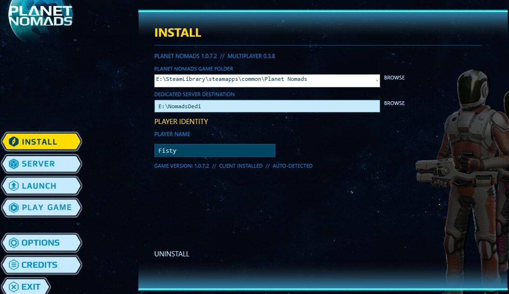
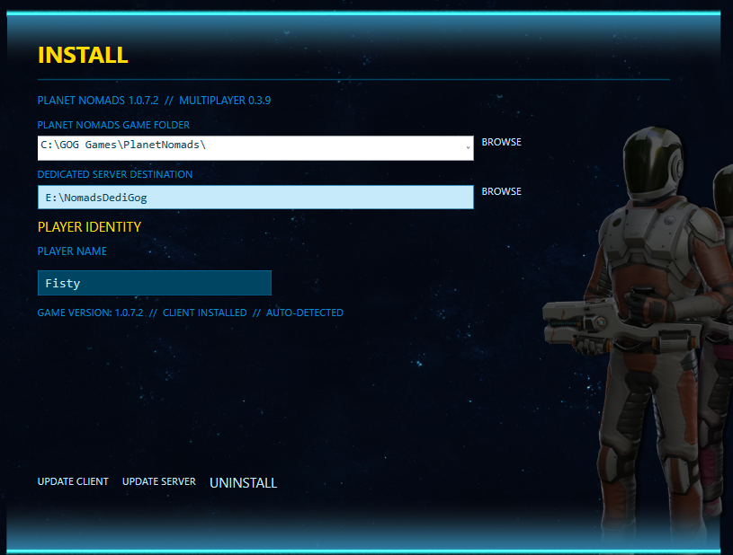

# Installation

**Compatibility: Planet Nomads Multiplayer supports vanilla Planet Nomads 1.0.7.2 only (Steam or GOG). Wand and imported custom blueprints that overwrite existing block IDs are not supported.**

## Windows — Multiplayer Manager 0.1.36



1. Download the **0.1.36 Manager installer** from [GitHub Releases](https://github.com/fistmaster2k4/Planet-Nomads-Multiplayer/releases) and run the setup executable.
2. Open **Planet Nomads Multiplayer Manager** using its desktop icon or Start Menu shortcut.
3. Under **INSTALL**, choose the component you want:
   - **INSTALL CLIENT** — select your existing Planet Nomads game folder (containing `PlanetNomads.exe`), enter your player name, then install.
   - **INSTALL SERVER** — select a dedicated-server destination, then install.
4. You can install either component without installing the other. If you install the second component later, the first installation is left unchanged.
5. For server hosting, open **SERVER**, choose the world, name, player limit, port and optional password, then click **SAVE SETTINGS**.
6. Under **LAUNCH**, click **LAUNCH SERVER**. Use **PLAY GAME** to launch the client if installed locally.

**Manager requirements:** Windows 10/11 and **.NET 8 Desktop Runtime (x64)**. Client installation also requires Planet Nomads **1.0.7.2**. The original game can be purchased from [GOG](https://www.gog.com/en/game/planet_nomads) (DRM-free) or [Humble Store](https://www.humblebundle.com/store/planet-nomads) (Steam keys, subject to availability). Both versions can play together in multiplayer.

Three ready-to-play starter worlds are included: Day1, Day2 and Day3. See [starter worlds](SERVER.md#included-starter-worlds) for their different terrain settings. To use your own single-player world, follow the [world setup instructions](SERVER.md#using-your-own-world).

## Standalone client — manual installation

The [standalone client releases](https://github.com/fistmaster2k4/Planet-Nomads-Multiplayer/releases) provide the client without the Manager. Choose the **0.3.71 Standalone Client** package. A matching **0.3.71 dedicated server** is required.

1. Download the standalone client ZIP from the **0.3.71 Standalone Client** release.
2. Open the Planet Nomads installation folder containing `PlanetNomads.exe`.
3. Extract the ZIP **directly into that folder**, preserving its directory structure. It includes BepInEx, the matching multiplayer and TNet plugins, configuration files, Doorstop, `winhttp.dll`, and the `version.txt` file required for game version 1.0.7.2 compatibility (including GOG installations).
4. Launch the game and select **Multiplayer** on the main menu.

### SteamOS / Linux using Proton (experimental)

For the standalone client under Proton, set the game's **Steam → Properties → General → Launch Options** to:

```text
WINEDLLOVERRIDES="winhttp=n,b" %command%
```

This makes Proton load the supplied BepInEx `winhttp.dll` proxy before Wine's built-in DLL. Without the override, the game may launch while BepInEx and the multiplayer menu do not.

BepInEx and TNet have loaded and connected under Proton on Steam Deck, but multiplayer world loading has not been confirmed working. SteamOS/Linux client support is experimental.

**Dedicated-server hosting is Windows-only.** The standalone ZIP contains the client, not the server.

## Blueprint sharing (Steam and GOG)

The Replicator exports blueprints into the local `UserConstructions` folder on both Steam and GOG. You can ZIP and share the complete numbered blueprint folder without Steam Workshop. See [Blueprint sharing instructions](BLUEPRINTS.md) for the folder location and an example using the Multiplayer Rover.

## Updates and removal

> **Important:** Existing multiplayer worlds can be upgraded to 0.3.71 without resetting the world or deleting its persistence databases. Back up the entire world folder before updating. Compatibility with substantially older builds is not guaranteed.



The INSTALL screen has separate client and server destinations. Once a component is installed, its button becomes **UPDATE CLIENT** or **UPDATE SERVER** when a newer version is available.


- The manager detects the client and server independently. **UPDATE CLIENT** or **UPDATE SERVER** appears when the included version is newer than the installed component.
- Updating one component leaves the other unchanged.
- If managed files have changed outside the Manager, the Manager detects those changes and handles confirmation and backup before replacement. 
- **Manager 0.1.36 includes client and dedicated server 0.3.71.** Update both components to use the new connection timeouts and diagnostics.
- Server updates preserve existing worlds and live server configuration. Do not delete the tree or other persistence databases when upgrading. See [What's new in 0.3.71](../README.md#whats-new-in-0371).
- Dedicated server 0.3.71 retains the automatic database cleanup introduced in 0.3.59 and cleans affected container databases on startup, preserving current inventory and machine state. Back up your world before updating; no manual database maintenance is required.
- **UNINSTALL** removes manager-managed client/server files while preserving saved worlds and unrelated files. Modified managed files may be retained.
- Windows **Uninstall** removes the manager application and shortcuts.

## Player backup

Under **OPTIONS**, use **BACKUP PROFILE** to save your player configuration, local saves and multiplayer identity. **RESTORE PROFILE** restores that backup.

Automatic profile backup is skipped when another `PlanetNomads.exe` client is still running and may be holding shared profile files open. Normal automatic backup is attempted when the final managed client exits. Dedicated-server world backups are separate.

**Keep profile backup ZIPs private.** They contain the identity information used by your multiplayer character.
