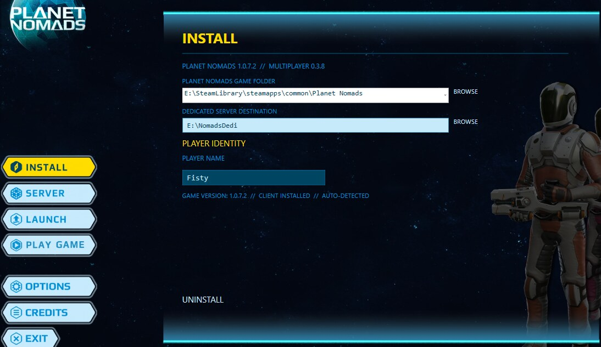

# Installation

## Requirements

- Windows with **.NET 8 Desktop Runtime (x64)** for the manager.
- An installed, licensed **Planet Nomads 1.0.7.2** for the multiplayer client.
- Network access for remote multiplayer; see [Server setup](SERVER.md).

The manager's own installer does **not** install the commercial game.

## Manager installer (0.1.21)

1. Run `PlanetNomadsManager-0.1.21-Setup.exe`. It installs the manager under the current user's `%LOCALAPPDATA%\Programs\PlanetNomadsMultiplayerManager` directory. Administrator elevation is not required.
2. Start the manager from the **Start Menu** or the **desktop icon**.
3. In **INSTALL**, select or confirm the existing game location and the desired dedicated-server folder.
4. Choose your player name. Install the client and server components as required.
5. Use **SERVER** to configure the world name, server name, port, password and administrator identity.
6. Use **LAUNCH** to run the server; use **PLAY GAME** to launch the existing `PlanetNomads.exe`.

A default dedicated-server world is included. See [Using your own world](SERVER.md#using-your-own-world) to create a custom world in single-player and copy it to the dedicated server.

The manager verifies a game-root `version.txt` identifying the compatible game build as `1.0.7.2`. Steam locations and common GOG paths can be discovered automatically, or entered manually. GOG runtime compatibility still requires a separate in-game test.

## Upgrade and removal

- **UPGRADE** is offered when an installed managed component is older than the bundled version.
- The manager tracks its own installed files, preserves manually modified files and leaves world saves untouched.
- **UNINSTALL** in the manager removes managed client/server components. This is different from uninstalling the **manager application** in Windows Settings.
- The Windows manager uninstaller removes the launcher and shortcuts. It **does not** remove separately installed client/server components or their saves.

## Player-profile backup

**OPTIONS → BACKUP PROFILE** creates an archive of the player's configuration, applicable local saves and multiplayer identity data. **RESTORE PROFILE** reinstates those files after creating a safety backup.

**Treat this ZIP as private.** It contains the profile identifier and private identity token used to recognize your player on dedicated servers. Never commit it to GitHub or post it publicly.

## Troubleshooting

- Launcher will not start: verify the .NET **8 Desktop Runtime (x64)** is installed.
- Game not found: browse to the original game installation; check `version.txt`.
- Remote player cannot connect: verify the chosen TCP port and router/firewall rules.
- Query/server-list status is not yet implemented; see [Current status](STATUS.md).
