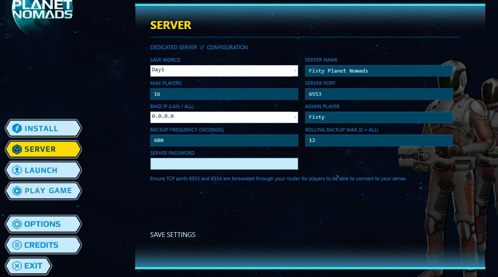
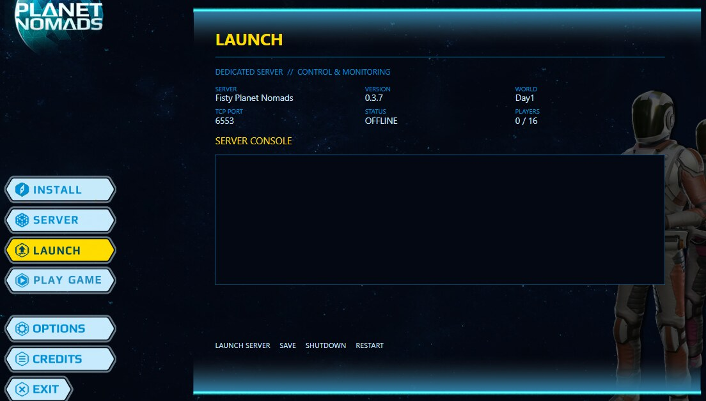
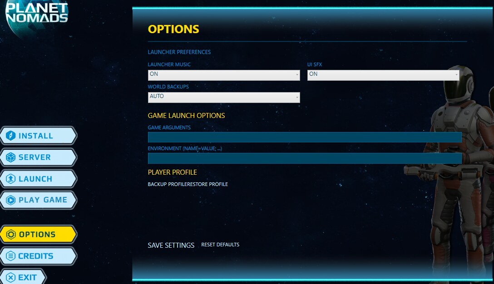

# Multiplayer Manager 0.1.21

## INSTALL

Choose your game folder, dedicated-server destination and player name. Install, upgrade or uninstall the multiplayer components.

## SERVER

Choose the server's world, name, port, password, administrator and backup settings. Click **SAVE SETTINGS** to apply changes.

## LAUNCH

Start the dedicated server inside the manager without opening another console window. Its live output appears here, together with server name, version, world, status and player count.

Buttons: **LAUNCH SERVER**, **SAVE**, **SHUTDOWN**, **RESTART**.

## PLAY GAME

Launches the original Planet Nomads game. The manager stays open on the same page so you can watch server activity on another monitor.

## OPTIONS

- **LAUNCHER MUSIC** and **UI SFX** — sound on/off.
- **WORLD BACKUPS** — automatic or manual.
- **GAME ARGUMENTS** — additional game launch options.
- **BACKUP PROFILE** and **RESTORE PROFILE** — back up your saves and multiplayer identity.
