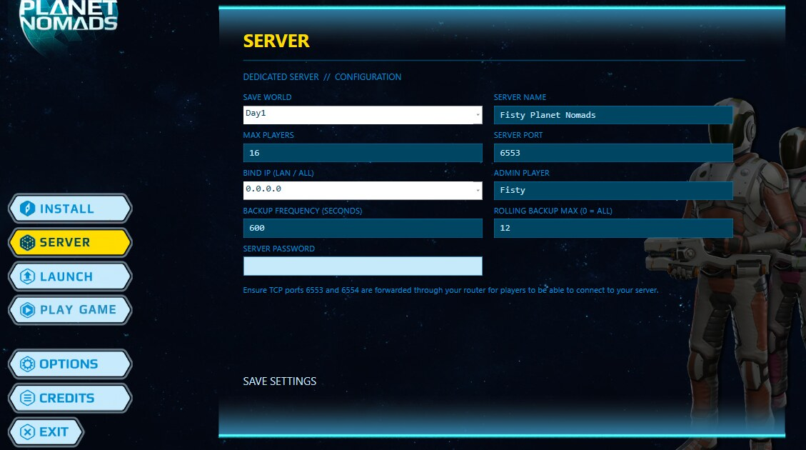
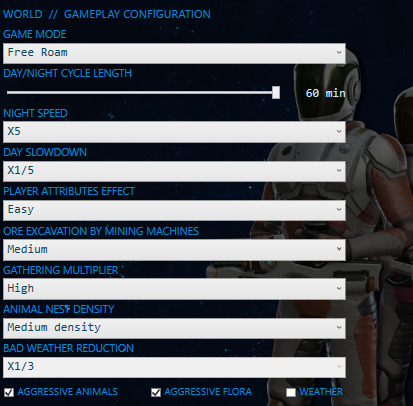
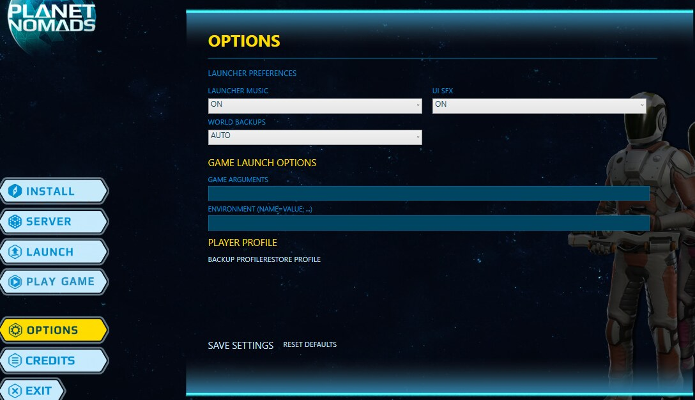

# Multiplayer Manager 0.1.28

## INSTALL

Choose **INSTALL CLIENT** for the Planet Nomads game folder or **INSTALL SERVER** for a dedicated-server destination. Only the selected component and its path are required.

The manager detects each installed component separately. **UPDATE CLIENT** and **UPDATE SERVER** appear when a newer version or payload revision is available. Installing or updating one component leaves the other unchanged.

The Manager 0.1.28 installer includes multiplayer client **0.3.30** and dedicated server **0.3.30**. Update both components when moving to this release. Existing worlds and live server configuration are preserved during server updates.

> **Known issue (0.1.28):** The Manager can incorrectly display client and server version **0.3.27** despite packaging **0.3.30** binaries. The version labels are currently hardcoded. This is documented in [issue #24](https://github.com/fistmaster2k4/Planet-Nomads-Multiplayer/issues/24) and is **to be fixed in the next scheduled update**; no emergency rebuild of 0.1.28 is planned. The inaccurate version metadata may also affect the Manager's upgrade prompts. When checking an installation, verify the actual deployed files.

> **Important:** Worlds created using older versions of Planet Nomads Multiplayer are not guaranteed to be compatible with this release. Back up existing worlds before updating. For the best experience, start a new world using one of the included starter worlds.

If managed files were modified outside the Manager, an update asks for confirmation and preserves copies of those files before replacing them. Declining leaves the installation unchanged.

## SERVER

Choose the server's world, name, port, password, administrator and backup settings. The redesigned SERVER page uses a two-column layout, with gameplay configuration alongside the server connection and hosting settings.

### World / Gameplay Configuration

Select a world under **SAVE WORLD**. Its gameplay settings load automatically. You can change these settings for an existing world without generating new terrain:

| Setting | Purpose |
| --- | --- |
| Game Mode | Select Survival, Free Roam or Creative. |
| Day/Night Cycle Length | Length of the day/night cycle in minutes. |
| Night Speed | Night-time progression multiplier. |
| Day Slowdown | Daytime progression slowdown. |
| Player Attributes Effect | Survival attribute difficulty. |
| Ore Excavation by Mining Machines | Mining-machine excavation setting. |
| Gathering Multiplier | Resource gathering yield. |
| Animal Nest Density | Density of animal nests. |
| Bad Weather Reduction | Reduction of bad-weather effects. |
| Aggressive Animals | Enable or disable aggressive animals. |
| Aggressive Flora | Enable or disable aggressive flora. |
| Weather | Enable or disable weather. |

Click **SAVE SETTINGS** to apply changes. Restart a running server to load the saved configuration.

> **Creative mode warning:** Switching an existing Survival or Free Roam world to Creative can permanently unlock technology for that world. Switching back does not undo those unlocks. The Manager displays a warning when Creative is selected; **UNDERSTOOD** dismisses the warning without saving the settings. Back up the entire world before changing to Creative.

The three included [starter worlds](SERVER.md#included-starter-worlds) offer different terrain and resource environments.

## LAUNCH

Start the dedicated server inside the manager without opening another console window. Its live output appears here, together with server name, version, world, status and player count.

Buttons: **LAUNCH SERVER**, **SAVE**, **SHUTDOWN**, **RESTART**.

## PLAY GAME

Launches the original Planet Nomads game. The manager stays open on the same page so you can watch server activity on another monitor.

## OPTIONS

- **LAUNCHER MUSIC** and **UI SFX** — sound on/off.
- **WORLD BACKUPS** — automatic or manual.
- **GAME ARGUMENTS** — additional game launch options.
- **BACKUP PROFILE** and **RESTORE PROFILE** — back up your saves and multiplayer identity.

### Automatic profile backups in 0.1.28

When the Manager launches a Planet Nomads client and automatic profile backup is enabled, it normally backs up the shared player profile after that client exits. **0.1.28 skips the automatic profile backup if another `PlanetNomads.exe` client is still running**, reducing collisions with locked files in the shared `AppData\LocalLow\Craneballs\PlanetNomads` profile (including `Saves\_main.db`). Once the last managed client exits, its normal automatic backup can proceed. This is separate from dedicated-server world backups.

### Multiplayer 0.3.30 bundled improvements

The included client and server deliver improved live server-clock synchronisation and shared sky progression, plus seated-player presentation in driven and undriven cockpits. Two empty adjacent rounded cockpits can both be used: when one becomes occupied, remote clients display the player at that cockpit's native seat pivot. Seated appearance does not grant driving or physics authority; those remain separate multiplayer controls. See the [main README](../README.md#whats-new-in-0330) for the release summary.
