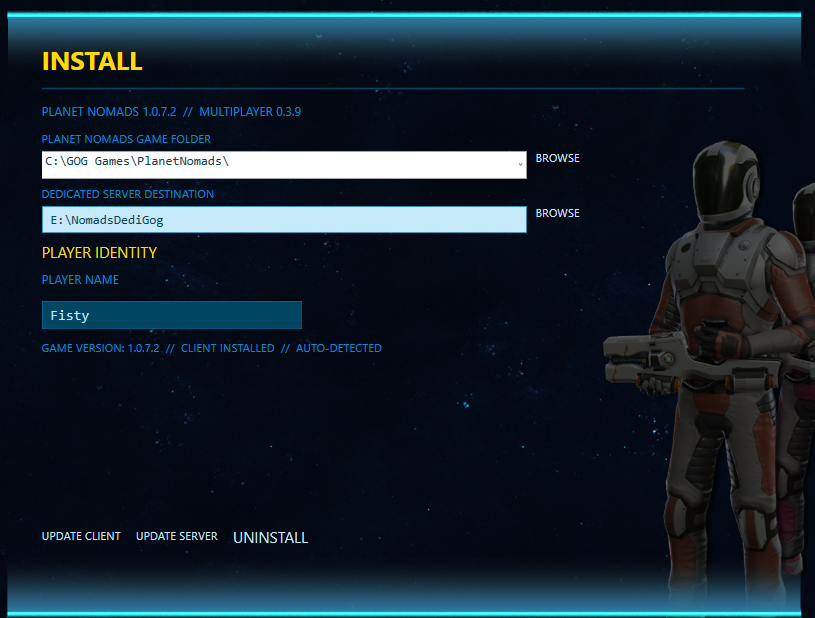

# Multiplayer Manager 0.1.26

## INSTALL

Choose **INSTALL CLIENT** for the Planet Nomads game folder or **INSTALL SERVER** for a dedicated-server destination. Only the selected component and its path are required.

The manager detects each installed component separately. **UPDATE CLIENT** and **UPDATE SERVER** appear when a newer version or payload revision is available. Installing or updating one component leaves the other unchanged.

The manager includes client **0.3.10** and dedicated server payload **0.3.8**. Both use the matching `v4-env1` protocol. The 0.1.26 package updates both payloads for shared dropped items, although their internal version numbers were not incremented. **Update both client and server** for dropped-item synchronization. The earlier flashlight-only change did not require a server update; this one does.

If you used Manager 0.1.25, Manager 0.1.26 detects the newer payload revision and offers client/server updates even when the displayed component versions match.

If managed files were modified outside the Manager, an update asks for confirmation and preserves copies of those files before replacing them. Declining leaves the installation unchanged.

## SERVER

Choose the server's world, name, port, password, administrator and backup settings. Click **SAVE SETTINGS** to apply changes.

### Changing world game mode (upcoming world-settings update)

> [!WARNING]
> Starting an existing world in **Creative** mode can permanently unlock its entire technology tree. Switching back to **Free Roam** or **Survival** does not restore the previous technology progression. This behaviour has been confirmed in multiplayer testing.
>
> Back up the complete server world folder, including its multiplayer persistence databases, before starting it in Creative mode if you want to preserve its original technology progression. Use a separate test world or a copy for Creative experiments. Restoring only the game mode setting is not sufficient.

## LAUNCH

Start the dedicated server inside the manager without opening another console window. Its live output appears here, together with server name, version, world, status and player count.

Buttons: **LAUNCH SERVER**, **SAVE**, **SHUTDOWN**, **RESTART**.

## PLAY GAME

Launches the original Planet Nomads game. The manager stays open on the same page so you can watch server activity on another monitor.

## OPTIONS

- **LAUNCHER MUSIC** and **UI SFX** — sound on/off.
- **WORLD BACKUPS** — automatic or manual.
- **GAME ARGUMENTS** — additional game launch options.
- **BACKUP PROFILE** and **RESTORE PROFILE** — back up your saves and multiplayer identity.
