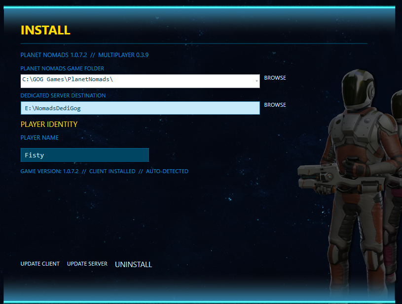
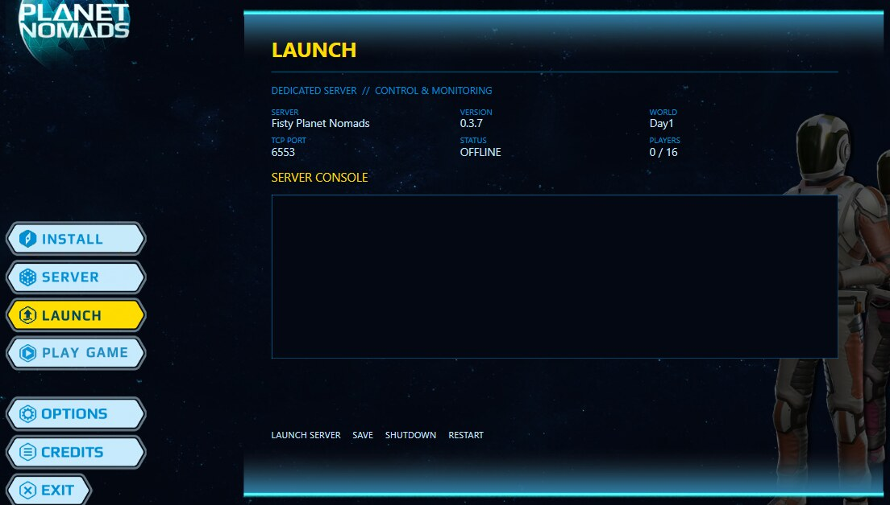

# Multiplayer Manager 0.1.32

**Compatibility: Planet Nomads Multiplayer supports vanilla Planet Nomads 1.0.7.2 only (Steam or GOG). Wand and imported custom blueprints that overwrite existing block IDs are not supported.**

## INSTALL

Choose **INSTALL CLIENT** for the Planet Nomads game folder or **INSTALL SERVER** for a dedicated-server destination. Only the selected component and its path are required.

The manager detects each installed component separately. **UPDATE CLIENT** and **UPDATE SERVER** appear when the packaged version or managed payload requires updating. It also recognises files changed or upgraded outside the Manager. Installing or updating one component leaves the other unchanged.

The Manager 0.1.32 installer includes multiplayer client **0.3.59** and dedicated server **0.3.59**. Update both components when moving to this release. Existing worlds and live server configuration are preserved during server updates.

> **Important:** Worlds created using older versions of Planet Nomads Multiplayer are not guaranteed to be compatible with this release. Back up existing worlds before updating. For the best experience, start a new world using one of the included starter worlds.

If managed files were modified outside the Manager, an update asks for confirmation and preserves copies of those files before replacing them. Declining leaves the installation unchanged.

## SERVER

Choose the server's world, name, port, password, administrator and backup settings. The redesigned SERVER page uses a two-column layout, with gameplay configuration alongside the server connection and hosting settings.

### World / Gameplay Configuration

Select a world under **SAVE WORLD**. Its gameplay settings load automatically. You can change these settings for an existing world without generating new terrain:

| Setting | Purpose |
| --- | --- |
| Game Mode | Select Survival, Free Roam or Creative. |
| Day/Night Cycle Length | Length of the day/night cycle in minutes. |
| Night Speed | Night-time progression multiplier. |
| Day Slowdown | Daytime progression slowdown. |
| Player Attributes Effect | Survival attribute difficulty. |
| Ore Excavation by Mining Machines | Mining-machine excavation setting. |
| Gathering Multiplier | Resource gathering yield. |
| Animal Nest Density | Density of animal nests. |
| Bad Weather Reduction | Reduction of bad-weather effects. |
| Aggressive Animals | Enable or disable aggressive animals. |
| Aggressive Flora | Enable or disable aggressive flora. |
| Weather | Enable or disable weather. |

Click **SAVE SETTINGS** to apply changes. Restart a running server to load the saved configuration.

> **Creative mode warning:** Switching an existing Survival or Free Roam world to Creative can permanently unlock technology for that world. Switching back does not undo those unlocks. The Manager displays a warning when Creative is selected; **UNDERSTOOD** dismisses the warning without saving the settings. Back up the entire world before changing to Creative.

The three included [starter worlds](SERVER.md#included-starter-worlds) offer different terrain and resource environments.

## LAUNCH

Start the dedicated server inside the manager without opening another console window. Its live output appears here, together with server name, version, world, status and player count. The Manager detects an existing dedicated-server process to prevent duplicate launches and lets you edit world settings when the server is stopped.

Buttons: **LAUNCH SERVER**, **SAVE**, **SHUTDOWN**, **RESTART**.

## PLAY GAME

Launches the original Planet Nomads game. The manager stays open on the same page so you can watch server activity on another monitor.

- **Steam installation:** Launches through Steam, retaining the Steam overlay and Steam Workshop blueprint access.
- **GOG installation:** Launches `PlanetNomads.exe` directly.

Use the Manager's configured client installation to launch the appropriate copy of the game.

## OPTIONS

- **LAUNCHER MUSIC** and **UI SFX** — sound on/off.
- **WORLD BACKUPS** — automatic or manual.
- **GAME ARGUMENTS** — additional game launch options.
- **BACKUP PROFILE** and **RESTORE PROFILE** — back up your saves and multiplayer identity.
- **REPORT BUG** — collect game and server diagnostics into a ZIP for a GitHub issue.

### Automatic profile backups

When the Manager launches a Planet Nomads client and automatic profile backup is enabled, it normally backs up the shared player profile after that client exits. **The Manager skips the automatic profile backup if another `PlanetNomads.exe` client is still running**, reducing collisions with locked files in the shared `AppData\LocalLow\Craneballs\PlanetNomads` profile (including `Saves\_main.db`). Once the last managed client exits, its normal automatic backup can proceed. This is separate from dedicated-server world backups.

### Report Bug

Under **OPTIONS → PLAYER PROFILE**, select **REPORT BUG** to collect information for a GitHub issue.

1. Choose where to save `NomadsBugReport.zip`. The default location is the dedicated-server installation folder.
2. The Manager packages available BepInEx client logs, dedicated-server logs, Unity `Player.log` files and the installed Manager, client and server versions.
3. A confirmation tells you where the ZIP was saved and the Manager opens the project's GitHub issue tracker.
4. Describe the problem in a new issue and attach the saved ZIP.

World saves and databases are not included.

### Multiplayer client/server 0.3.59 bundled improvements

**Performance and stability:** Improved inventory and vehicle responsiveness, fixed inventory opening failures and removed redundant network requests, callbacks and recurring Terraformer obstruction checks.

**Database maintenance:** Existing affected container databases are automatically cleaned on server startup, preserving current inventory and machine state. Excessive database growth caused by unnecessary persistent transaction records has been fixed.

**Fixes:** Corrected Terraformer production stalls, overlay leakage and queue icon alignment. Build Vision defaults to OFF on joining a multiplayer world.

### Previous: multiplayer client/server 0.3.43 improvements

**Terraformer:** A late-game machine unlocked alongside the Nuclear Generator that restores harvested trees within 100 metres. Requires nuclear-generator-level electricity, **1 seed and 5 biomass per tree** from its inventory or connected storage, and **two in-game days per tree** based on the server's day length. Progress survives restarts; it stops consuming electricity when finished. **Overlapping Terraformers cannot operate.**

**Shared expedition history:** Completed quests, objective progression, journal entries and discovered story logs are shared across the server and retained for reconnecting and late-joining players.

**Fixes:** Restored the Biomass Stove to starting technology, fixed harvested resource remnants and server-rejoin errors, and improved Terraformer progress displays.

### Previous: multiplayer client/server 0.3.36 improvements

Replicator-printed vehicles and structures, including Steam Workshop blueprints, are registered with the dedicated server so they persist through player disconnects and reconnects. The replication covers child grids, suspension assemblies, electrical connections and component settings, and resolves cockpit interaction problems on printed vehicles.

A Steam-built Workshop rover has been confirmed visible and usable from a GOG client in the same world. A short delay after printing may occur while the construction is handed off to the server and settles.

### Earlier improvements from 0.3.34

Client and server **0.3.34** add shared-world support for the automated **Biomass Miner**, using native terrain-contact checks for operation and displaying drilling progress, estimated yield and harvested output.

This release also fixes multiplayer respawning and vehicle logout behaviour, and simplifies the pause menu to **Continue**, **Options** and **Logout**, so leaving a session no longer exits the game. See [the 0.3.34 notes](../README.md#previous-release-0334) and [the current 0.3.59 update](../README.md#whats-new-in-0359).

## Sharing blueprints

Steam and GOG players can exchange locally exported Replicator constructions by ZIPping the numbered blueprint folder and extracting it into the recipient's `UserConstructions` directory. With client/server 0.3.59, structures printed through the native Replicator are synchronised and persisted by the dedicated server, including Steam Workshop blueprints. See [Blueprint sharing](BLUEPRINTS.md) for instructions and the Multiplayer Rover example.
