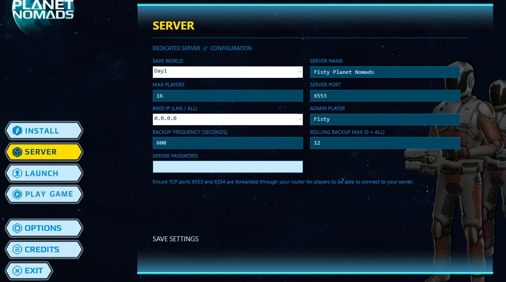
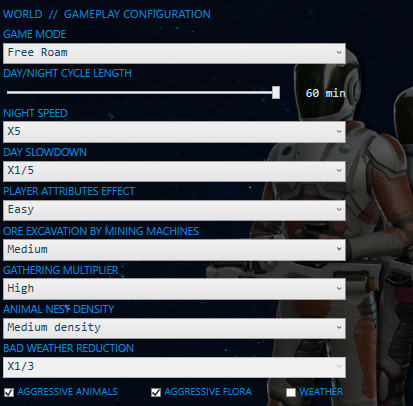

# Dedicated server



The current bundled server is **v0.3.27**, compatible with multiplayer client **v0.3.27**, supplied with Manager **0.1.27**. Update both client and server together.

> **Important:** Worlds created using older versions of Planet Nomads Multiplayer are not guaranteed to be compatible with this release. Back up existing worlds before updating. For the best experience, start a new world using one of the included starter worlds.

Dropped items now use server-owned shared state. Either connected player can see and collect an item dropped by another player (verified in-game). Partial pickups, concurrent collection safeguards, reconnect/late-join recovery and restart persistence passed automated regression tests; full in-game verification of those edge cases is still pending.

World time is owned by the dedicated server. Joining and reconnecting players receive its current time, and the server manages independent weather schedules for the game's 25 biome profiles. Existing client-side sky, shelter and atmospheric presentation remain native.

## Multiplayer gameplay

The server coordinates player respawning, shared sleeping, vehicle physics authority, electrical connections and battery state. Sleeping requires all connected players to agree, using Sleeping Bags or powered Cryopods. Vehicle physics authority can move between players while vehicle and electrical state remain shared.

The Biomass Stove is available from starting technology in multiplayer. It uses its own biomass-fuelled power supply to produce dried fruitage, dried meat and purified water. See the [0.3.27 feature overview](../README.md#whats-new-in-0327).

## Included starter worlds

The dedicated server includes three pre-generated worlds, each deliberately created with different terrain settings.

| World | Terrain and starting conditions | Ideal for |
| --- | --- | --- |
| **Day1** | Very flat terrain with a low water table | Large bases, expansive construction and wheeled vehicles |
| **Day2** | Slightly raised terrain with excellent starter materials around the player | Cooperative survival and early progression |
| **Day3** | More rugged terrain | Challenging exploration and specialist vehicle engineering |

Select a world under **SERVER → SAVE WORLD**, click **SAVE SETTINGS**, then launch your server.

## Using your own world

1. Launch the original **Planet Nomads**.
2. Create a new single-player game or custom single-player world.
3. Enter the world, **save**, then quit the game.
4. In Windows File Explorer, paste this location into the address bar:

   ```text
   %USERPROFILE%\AppData\LocalLow\Craneballs\PlanetNomads\Saves
   ```

5. Copy **`_main.db`** and **`_working.db`**. You don't need the numbered `save_*.db` files.
6. In your dedicated-server installation's **Saves** folder, create a new folder named after your world, such as **MyWorld**.
7. Paste the two copied files into **MyWorld**.
8. Open the manager's **SERVER** page, choose **MyWorld** from **SAVE WORLD**, then click **SAVE SETTINGS**.
9. Select **LAUNCH → LAUNCH SERVER**.

**Copy the files; don't move them.** Your original single-player save stays in place.

## Server settings

The **SERVER** screen lets you choose:

- **Save World** — the world to load.
- **Server Name** — the name of your server.
- **Max Players** — player limit.
- **Server Port** — default **6553**.
- **Bind IP** — **0.0.0.0** for all available local network interfaces.
- **Admin Player** — your chosen administrator character.
- **Backup Frequency / Rolling Backup Max** — automatic server-save backups.
- **Server Password** — optional password for joining.

The **World / Gameplay Configuration** section also provides per-world settings for game mode, day/night cycle length, night speed, day slowdown, player attributes, mining-machine excavation, gathering multiplier, animal nest density, bad weather reduction, aggressive animals, aggressive flora and weather. See [Manager gameplay configuration](MANAGER.md#world--gameplay-configuration) for details and the Creative mode warning.



Click **SAVE SETTINGS** when finished. Restart the server to load the saved settings if it is running.

## World backups

Back up the entire selected world folder, including `_main.db`, `_working.db` and all multiplayer persistence databases, before updating or changing game modes. The multiplayer databases store construction, containers, drops, electricity, environment, players and technology state. Copying only the two native databases is appropriate for importing a new single-player world, not for preserving a complete existing multiplayer world.

## Allowing friends to connect

Forward the selected **TCP server port** through your router to the computer running the server, and allow it through Windows Firewall.

The manager also displays the following TCP port as a reminder, but the separate query service is **not active** in this version.
